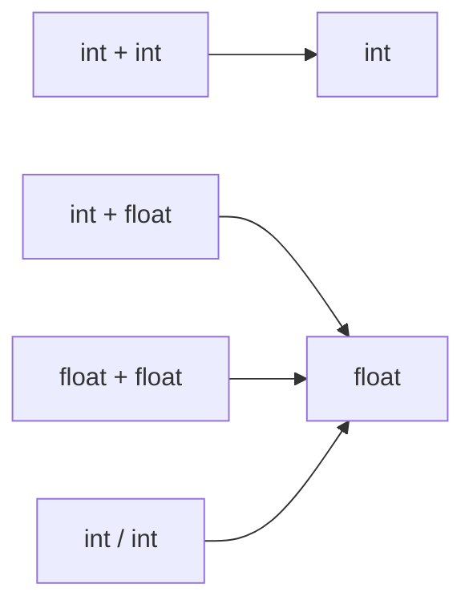
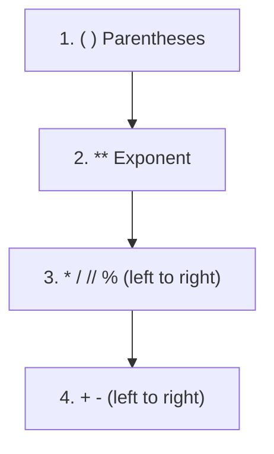
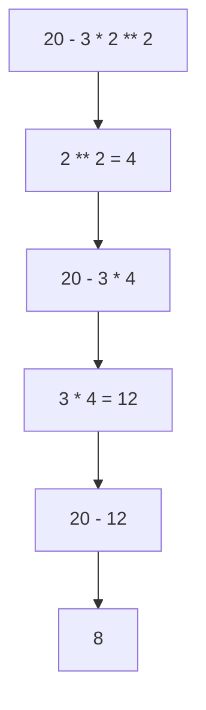
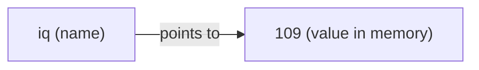
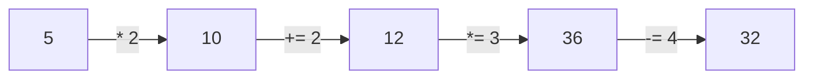

# Python Fundamentals: Numbers & Operators

## 1. Fundamental Data Types: `int` and `float`

| Type    | Example        | Notes                         |
|---------|----------------|-------------------------------|
| `int`   | `6`, `-4`      | Whole numbers, unlimited size |
| `float` | `10.56`, `2.0` | Decimal numbers               |

```python
print(type(10.56))      # <class 'float'>
print(type(2 - 4))      # <class 'int'>
print(type(2 * 4))      # <class 'int'>
print(type(2 / 4))      # <class 'float'>  -> "/" ALWAYS returns a float
print(type(9.9 + 1.1))  # <class 'float'>  -> float + float = float
print(9.9 + 1.1)        # 11.0
```

**Rule:** `/` always returns a `float`. When `int` and `float` are mixed, Python automatically converts the `int` to `float`.



## 2. Arithmetic Operators

| Operator | Name           | Example  | Result | Meaning                                |
|----------|----------------|----------|--------|----------------------------------------|
| `+`      | Addition       | `5 + 4`  | `9`    |                                        |
| `-`      | Subtraction    | `5 - 4`  | `1`    |                                        |
| `*`      | Multiplication | `5 * 4`  | `20`   |                                        |
| `/`      | Division       | `2 / 4`  | `0.5`  | Always `float`                         |
| `**`     | Power          | `2 ** 3` | `8`    | 2 raised to the power 3                |
| `//`     | Floor division | `5 // 4` | `1`    | Largest integer <= the division result |
| `%`      | Modulus        | `5 % 4`  | `1`    | Remainder of the division              |

```python
print(2 ** 2)   # 4
print(2 ** 3)   # 8
print(2 // 4)   # 0  (0.5 floored down)
print(5 // 4)   # 1  (1.25 floored down)
print(5 % 4)    # 1  (5 = 4*1 + 1)
```

> Floor division rounds **down**, so `-5 // 4` is `-2`, not `-1`.

## 3. Math Functions

```python
print(round(3.1))  # 3  -> nearest integer
print(abs(-3))     # 3  -> absolute value
```

## 4. Operator Precedence

Python evaluates operators in this order (highest to lowest):

1. Parentheses `()`
2. Exponentiation `**`
3. Multiplication, division, floor division, modulus `*`, `/`, `//`, `%` (left to right)
4. Addition and subtraction `+`, `-` (left to right)



### Worked example: `20 - 3 * 2 ** 2`



### Examples

```python
print(20 - 3 * 4)             # 8    multiplication before subtraction
print((20 - 3) * 4)           # 68   parentheses first
print(20 - 3 ** 2)            # 11   20 - 9
print((20 - 3) ** 2)          # 289  17 ** 2
print(20 - 3 * 2 ** 2)        # 8    20 - 3*4
print((20 - 3 * 2) ** 2)      # 196  (20 - 6) ** 2
print(20 - (3 * 2) ** 2)      # -16  20 - 36
print(20 - 3 ** 2 * 2)        # 2    20 - 9*2
print((20 - 3 ** 2) * 2)      # 22   (20 - 9) * 2
print(20 - 3 ** 2 * (2 + 1))  # -7   20 - 9*3
```

Same numbers, different grouping (from `execise.py`):

```python
print((5 + 4) * 10 / 2)    # 45.0
print(((5 + 4) * 10) / 2)  # 45.0
print((5 + 5) * (10 / 2))  # 50.0
```

**Tip:** When unsure, add parentheses. It costs nothing and makes the intent clear.

## 5. Extra: Binary Representation

Integers are stored in memory in binary.

```python
print(bin(5))           # '0b101'  -> int to binary string
print(int('0b101', 2))  # 5        -> binary string back to int (base 2)
```

## 6. Remember

- `/` always gives a `float`; use `//` for an integer-style result.
- `**` binds tighter than `*`, `/`, `+`, `-`.
- Use `%` for remainders (e.g. even/odd check: `n % 2 == 0`).
- Cleanup: `from mimetypes import init` at the top of `fundament.py` is an accidental auto-import and can be deleted.

---

# Python Fundamentals: Variables

A variable stores information (a value) so we can reuse it in our program.

```python
iq = 109
print(iq)  # 109
```



## 1. Variable Naming Rules

| Rule                                | Good                     | Bad                          |
|-------------------------------------|--------------------------|------------------------------|
| Use `snake_case`                    | `user_age`               | `userAge`                    |
| Start with a lowercase letter or `_`| `iq`, `_user_id`         | `1user`                      |
| Only letters, numbers, underscores  | `user41`                 | `user-41`, `user 41`         |
| Case sensitive                      | `user_IQ` != `user_iq`   | using `user_iq` for `user_IQ`|
| Don't overwrite keywords            | `class_name`             | `class`, `if`, `for`         |

```python
iq = 109
_user_id = 190
user41 = "180"      # a str, because of the quotes
user_IQ = 200

# print(user_iq)    # NameError: names are case sensitive (user_IQ was defined)
```

## 2. Two Small Gotchas

```python
# Constants: UPPER_CASE by convention (Python does not enforce it)
PI = 3.14           # signals "this value never changes"

# Avoid names with double leading underscores
# __hi = "hi"       # reserved for special Python behavior; don't use

# Multiple assignment
e, b, c = 1, 2, 3
print(e, b, c)      # 1 2 3
```

## 3. Expression vs Statement

- **Expression:** produces a value, e.g. `iq / 4`.
- **Statement:** performs an action, e.g. `user_age = iq / 4`.

```python
user_age = iq / 4   # right side is the expression, whole line is the statement
print(user_age)     # 27.25
```

## 4. Augmented Assignment Operators

Shortcut for updating a variable using its own previous value. The operator goes to the **left** of `=`.

```python
some_value = 5
some_value = some_value * 2   # 10 (name now points to a new value in memory)
some_value += 2               # 12  same as some_value = some_value + 2
some_value *= 3               # 36
some_value -= 4               # 32
print(some_value)             # 32
```



Also available: `/=`, `//=`, `%=`, `**=`.

## 5. Remember

- Variables are names pointing to values; reassigning points the name to a new value.
- Names are case sensitive; stick to `snake_case`.
- Constants use `UPPER_CASE`.
- Never use a keyword as a variable name.
- A leading space on a line causes `IndentationError`.
